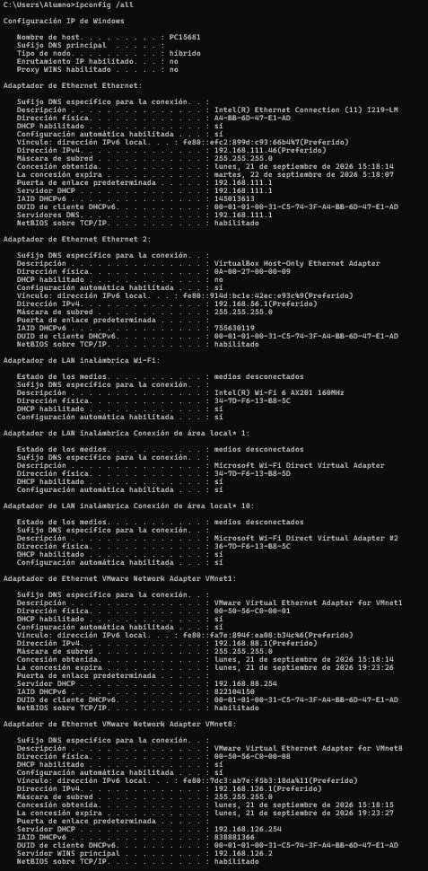
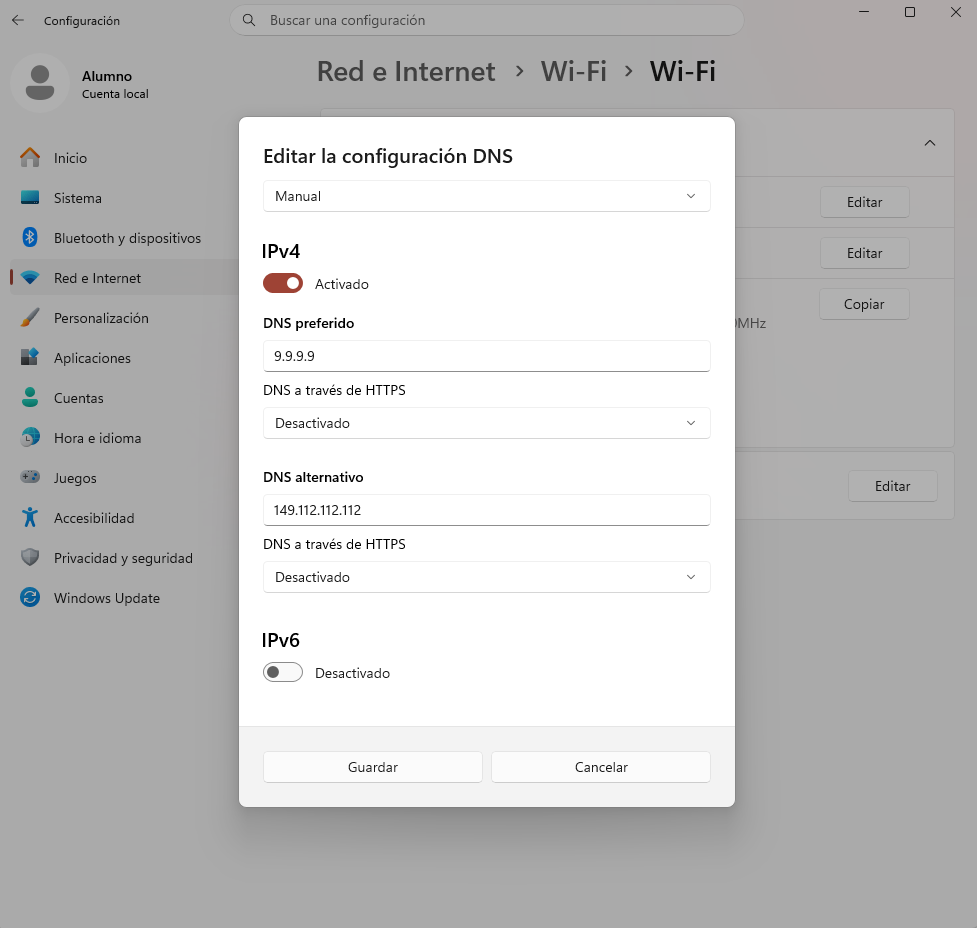

# Parte 2: Configuración y Caché [2p]

> Todo sistema operativo guarda las resoluciones DNS para no saturar la red.

---

## 1. Cambio de servidores DNS

### 1.1. ¿Cómo puedes ver mediante consola (CLI) qué servidores DNS tienes asignados actualmente en Windows y en Linux?

**Windows (PowerShell o CMD):**
```powershell
ipconfig /all
```

Este comando muestra toda la configuración de red. En la sección del adaptador activo se encuentra la línea "Servidores DNS" con las IPs de los DNS primario y secundario configurados.

**Linux:**
```bash
resolvectl status
```

En distribuciones modernas con systemd-resolved, muestra el estado de los resolutores DNS. La sección "Current DNS Server" indica el servidor en uso. También se puede consultar el archivo `/etc/resolv.conf` que contiene líneas `nameserver` con las IPs de los servidores DNS.

**Captura:**



---

### 1.2. Cambia la configuración de red de tu equipo principal poniendo como DNS primario y secundario los que obtuviste en el Benchmark de la Fase 1

DNS a configurar (obtenidos del benchmark con DNS Jumper):
- DNS primario: 9.9.9.9 (Quad9 Security)
- DNS secundario: 149.112.112.112 (Quad9 Security)

**Pasos en Windows:**
1. Configuración → Red e Internet → Wi-Fi (o Ethernet, según tu conexión activa)
2. Propiedades del adaptador de red → Protocolo de Internet versión 4 (TCP/IPv4) → Propiedades
3. Seleccionar "Usar las siguientes direcciones de servidor DNS"
4. DNS preferido: 9.9.9.9
5. DNS alternativo: 149.112.112.112
6. Aceptar

Verificación del cambio:
```powershell
ipconfig /all
```

**Captura:**



---

## 2. Gestión de la caché DNS (ipconfig / resolvectl)

### 2.1. Muestra una captura de pantalla de algunas direcciones almacenadas en la caché de tu equipo

```powershell
ipconfig /displaydns
```

Este comando muestra el contenido de la caché DNS del cliente de Windows. Cada entrada contiene:
- Nombre de registro (el dominio resuelto)
- Tipo de registro (A, AAAA, CNAME, etc.)
- Tiempo de vida (TTL): segundos restantes antes de expirar
- Datos: la IP asociada

**Captura:** `capturas/parte2/cache-dns.png`

---

### 2.2. Vacía la caché de tu equipo y explica para qué es útil esta acción

```powershell
ipconfig /flushdns
```

Respuesta esperada:
```
Se vació correctamente la caché de resolución DNS.
```

**Captura:** `capturas/parte2/flush-dns.png`

Vaciar la caché DNS es útil para un administrador de sistemas por varias razones:

1. **Aplicar cambios de IP inmediatamente:** Cuando se migra un servicio a un nuevo servidor, los equipos con la IP antigua en caché no verán el cambio hasta que expire el TTL. Vaciar la caché fuerza la resolución desde el servidor DNS.

2. **Troubleshooting de conectividad:** Si un usuario no puede acceder a un sitio pero otros sí, puede deberse a una entrada DNS corrupta o desactualizada en la caché local.

3. **Prevenir DNS poisoning:** Si un equipo está resolviendo dominios a IPs maliciosas por un ataque de envenenamiento de caché, vaciar la caché elimina las entradas comprometidas.

4. **Forzar uso de servidores DNS nuevos:** Tras cambiar los servidores DNS, vaciar la caché garantiza que las nuevas resoluciones pasen por los nuevos servidores.

5. **Eliminación de entradas NXDOMAIN cacheadas:** Las respuestas negativas (dominio no existe) también se cachean. Si el dominio se registra después, el equipo no lo resolverá hasta que expire el TTL negativo.

---

## Checklist Parte 2

- [x] Comandos CLI para ver DNS (Windows y Linux) ejecutados y capturados
- [x] DNS cambiados a 9.9.9.9 y 149.112.112.112 (Quad9)
- [x] Captura del cambio de DNS
- [ ] ipconfig /displaydns ejecutado y capturado
- [ ] ipconfig /flushdns ejecutado y capturado
